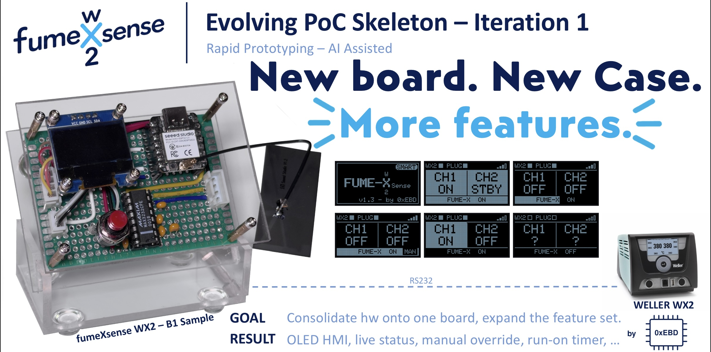
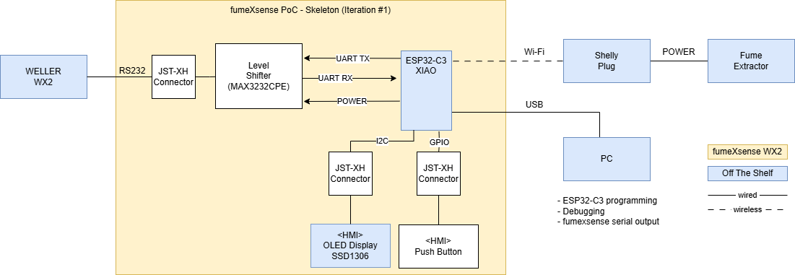
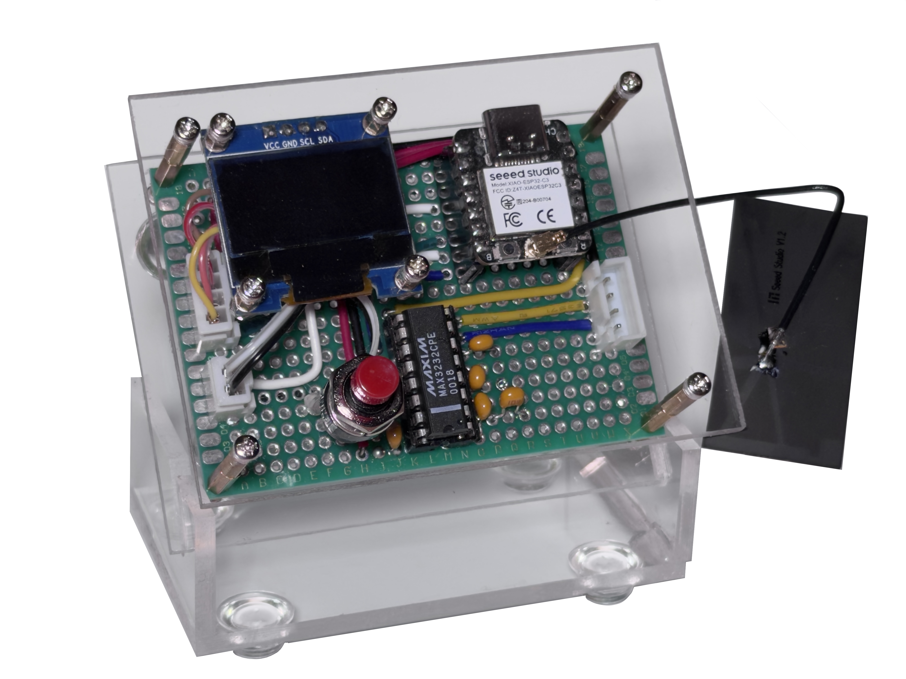
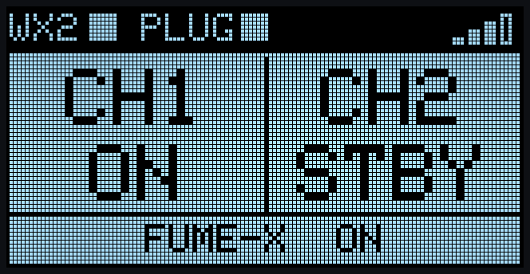
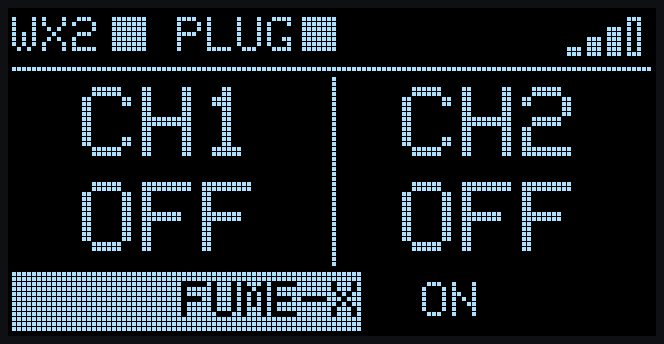
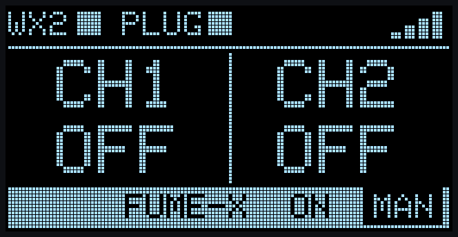
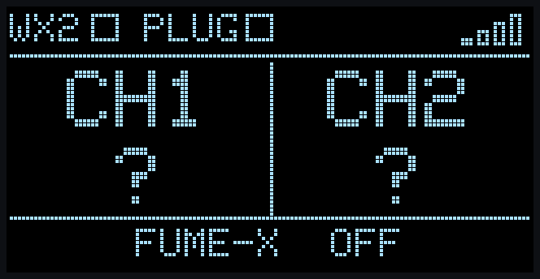

# PoC – ESP32-C3 – From "Hello WX2" to a Workbench-Ready Skeleton

**Type:** 🧪 Proof of Concept  
**Status:** ✅ Completed

**Summary: The embedded skeleton gets a face, a home, and new tricks.**

This is the first iteration built on the ["Hello WX2"](../001_hello_wx2/README.md) embedded skeleton - the minimal, headless controller that switched the fume extractor automatically based on the Weller WX2 channel states.
This iteration brings together several smaller PoC increments developed privately and moves the system closer to its intended target configuration.

The previously headless controller now has a compact acrylic enclosure, an OLED status display, and a push button. The base board and ESP32 shield have become a single prototype board, with a 3.3 V RS-232 transceiver simplifying the electrical interface. Meanwhile, the software gains status feedback and user interaction.

Most importantly, the setup can now sit on my workbench and be used during actual soldering sessions - providing fast feedback on what works well and what needs improvement next.

## Goal

**Make the embedded PoC usable, observable, and easier to experiment with - without rebuilding what already works.**

- **System:** Create a compact, self-contained workbench setup that enables feedback from real-world use.
- **Hardware:** Consolidate the base board and ESP32 shield, integrate the HMI, and simplify the 3.3 V signal interface.
- **Software:** Make system states visible and add push-button control while preserving the existing core control loop.
- **AI-assisted development:** Keep exploring rapid feature development and extend agent use from coding into GitHub repository and release workflows.

## Documentation

The PoC documentation consists of three documents:

- 📄 Overview (this page): goal, strategy, system overview and results
- 🔧 [Hardware](hw/README.md) -- B1 sample board, acrylic case, OLED display, push button, and pinout
- 💻 [Software](sw/README.md) -- HMI layout, button behavior, build, and run instructions

## PoC Strategy

**Evolve the working skeleton through rapid, incremental experimentation.**

["Hello WX2"](../001_hello_wx2/README.md) provided the minimal working control loop. I kept that foundation, reused proven hardware, and explored several feature ideas in smaller private increments before combining them for this publication.

The trade-off was intentional: prioritize fast experimentation and testing against real hardware over restructuring the single-loop software architecture. That decision helped get the HMI into use quickly - and exposed limitations worth tackling in a future iteration.

AI-assisted development continued throughout. I also experimented with extending coding-agent responsibilities into GitHub branch, tag, and publication workflows.

## PoC System Overview

### Architecture

The Seeed Studio XIAO ESP32-C3 remains the central controller. It reads the Weller WX2 via a MAX3232 RS-232 transceiver, shows status on the OLED, takes input from the push button, and controls the extractor through a Shelly smart plug over Wi-Fi.

For wiring, component, and firmware details, see [Hardware](hw/README.md) and [Software](sw/README.md).

### What Changed

#### A board and a home

The separate base board and ESP32 shield have been consolidated into one hand-wired B1 prototype board. Switching from the 5 V MAX232 to a 3.3 V MAX3232CPE removes the need for an additional logic-level adaption between the transceiver and the ESP32-C3.

A custom clear acrylic enclosure holds the board at an angle, with the display and push button facing the user. It's still a PoC, but now it's a setup I can actually keep beside the soldering station.

#### A face: live status on a tiny OLED

The 128×64 SSD1306 OLED makes the system observable without opening a serial console or an app. It shows WX2 and Shelly connectivity, Wi-Fi signal strength, both WX2 channel states, and the extractor state. A countdown bar makes the 30-second run-on visible; warnings and manual-mode status have their own indicators.

<table>
  <tr>
    <td> Soldering: CH1 ON, CH2 standby, extractor ON</td>
    <td> Run-on: the bar counts down the remaining time</td>
  </tr>
  <tr>
    <td> Manual mode (long press)</td>
    <td> WX2 and Shelly not reachable</td>
  </tr>
</table>

*These screens weren't photographed -- they're pixel-accurate renderings generated directly from the display code. How that happened is in [Lessons Learned](#lessons-learned).*

#### A button -- and a few new tricks

One tactile button adds direct control: a **short press** cancels an active run-on and switches the extractor off; a **long press (≥ 800 ms)** toggles manual mode, keeping extraction running until the next long press.

An animated splash screen appears at startup for about five seconds and can be skipped with a short press before the "Connecting…" screen. The firmware also continues running when no OLED is connected.

Crucially, the automatic extractor behavior from ["Hello WX2"](../001_hello_wx2/README.md) remains in place: extraction starts when either WX2 channel is ON, stops after a 30-second run-on, and retains Shelly state validation, adoption of external changes, and the power-based health check.

## Demonstrated Result

- ✅ Workbench-ready, self-contained prototype
- ✅ Base board and ESP32 shield merged into one B1 board
- ✅ MAX3232 replaces MAX232 -- native 3.3 V signals, no voltage divider
- ✅ Beautiful clear acrylic case 😎
- ✅ Live status on the OLED -- no serial console or app needed
- ✅ Push-button control: cancel run-on, toggle manual mode
- ✅ Button input captured even during blocking WX2 communication
- ✅ Automatic extractor control from "Hello WX2" fully preserved

Next stop: Solder, solder, solder ...

## Known Limitations

This PoC prioritizes rapid experimentation over production readiness. Several limitations remain:

- **Blocking software architecture:** The firmware uses a single-threaded, blocking loop. Button events are captured during WX2 communication but processed afterwards. Display updates are also tied to the approximately 1-second polling cycle.
- **Compile-time configuration:** Changing system parameters requires modifying the source code and recompiling the firmware.
- **Missing OLED screensaver:** Reusing a display from an earlier project revealed visible burn-in from its previous HMI. A screensaver or automatic display timeout is needed to reduce further wear.
- **Custom WX2 cable:** The JST-XH connector requires a custom cable to connect to the WX2. 
- **Prototype hardware:** The B1 sample is built on hand-wired perfboard, without a formal schematic or PCB layout.
- **Limited verification:** Functional testing has been performed on a single hardware setup. No systematic testing has been conducted.

For implementation details and exact behavior, see the [Hardware](hw/README.md) and [Software](sw/README.md) documents.

## Lessons Learned

Getting the PoC onto my workbench changed the way I could experiment with it.

- **Real-world use beats assumptions.** Having a working PoC right next to the soldering station makes it easy to explore new features in their actual system context. Ideas can be tested immediately while doing the real thing -- soldering.

- **AI makes experimentation playful.** AI-assisted development makes it incredibly fast to explore ideas, try alternatives, and discard what doesn't work. GitHub provides the structure to keep the codebase organized and preserve working milestones along the way.

- **AI coding agents create a compounding effect.** Well-documented commits and pull requests preserve not just what changed, but why. Over time, this development history becomes a growing source of context that AI agents can use to understand previous decisions, revisit feature increments, and build on existing work. Searching through the project's history for specific features and changes using AI was a breeze.

- **AI agents are still full of surprises.** I asked Claude to prepare the next GitHub publication. It went beyond creating folders and branches -- adapting documentation based on previous posts, updating links, and even generating useful use cases. But the real surprise? It created pixel-accurate HMI mockups directly from the display source code, even though those screens don't exist as bitmap files! This solved a problem I hadn't even asked it to address: photographing the OLED with my phone was difficult because its slow refresh caused partially rendered screens. Claude found an unexpected workaround. ;-)

- **Physical usability reveals its own surprises.** The acrylic case looks good, but its center of gravity isn't ideal for one-handed operation. The ESP32's USB connector faces an inconvenient direction -- routing it parallel to the WX2 cable would make much more sense. And operating a physical button while soldering, especially with dirty fingers, isn't as convenient as expected.

These are exactly the kinds of findings I wanted from this iteration: **get the system into real use, discover what actually matters, and feed those insights into the next design.**

## Next Step

Keep evolving the skeleton. With the HMI in place and the setup ready for use, the limitations of the blocking single-loop architecture are easier to see. A task-based architecture is a natural next experiment. Also the hw could use some more tweaking.

## ⚠️ Safety ⚠️

This setup taps into the interface of a mains-powered soldering station and switches mains power via a smart plug. Build and use it at your own risk. Never leave the setup unattended during operation.

Do not rely on this project as the sole means of protection against soldering fumes.

## LinkedIn Posts

I'm documenting selected milestones and lessons from fumeXsense wx2 in a LinkedIn series. The posts tell the development story; this repository contains the engineering artifacts.

Only the kick-off post and this iteration are listed below. For the posts in between and the complete series, see the [fumeXsense main README](../../../../README.md#linkedin-posts).

<table>
  <thead>
    <tr><th>Post</th><th>Topic</th><th>Status</th><th>Link</th></tr>
  </thead>
  <tbody>
    <tr>
      <td>01</td><td>Introducing fumeXsense wx2</td><td>✅ Posted</td>
      <td><a href="https://www.linkedin.com/posts/andreas-jarosch_embeddedsystems-esp32-maker-activity-7502718935780327424-sQWo">LinkedIn</a></td>
    </tr>
    <tr>
      <td>04</td><td>Onto the Workbench</td><td>✅ Posted</td><td>LINK</td>
    </tr>
  </tbody>
</table>

## Disclaimer

fumeXsense wx2 is an experimental, open-source maker project, not a certified or commercially supported product.

It is not affiliated with or endorsed by Weller or Shelly.

The software and hardware designs are provided "AS IS", without warranty. Users are responsible for evaluating their own implementations and ensuring safe installation and operation, particularly when working with mains-powered equipment and fume extraction.

Weller® and Shelly® are registered trademarks of their respective owners.

## License

See the [fumeXsense main README](../../../../README.md#licenses) and the [licenses](../../../../licenses/) directory.