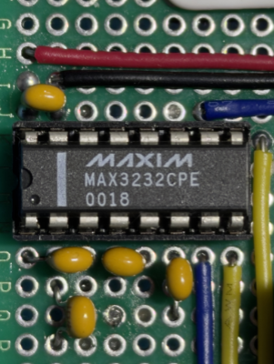
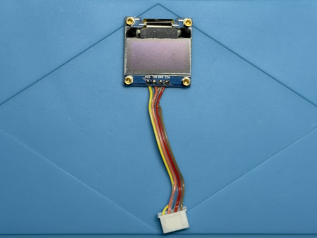
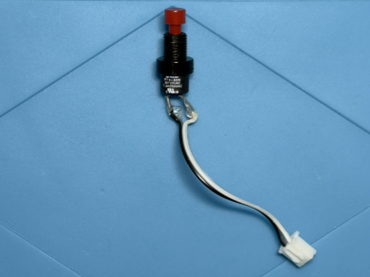
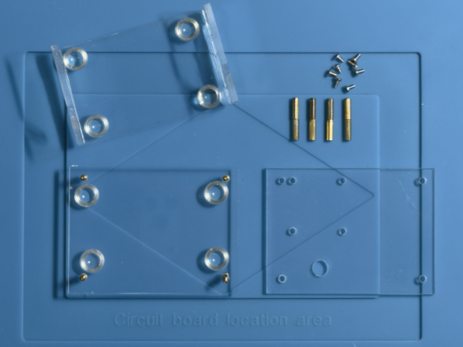
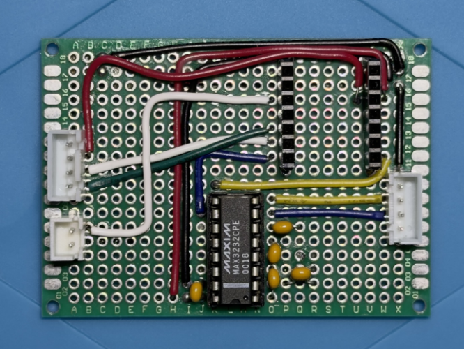

# PoC Hardware - PoC – ESP32-C3 – From "Hello WX2" to a Workbench-Ready Skeleton

← Back to the [PoC overview](../README.md) · See also: [Software](../sw/README.md)

⚠️ Before building or connecting anything, read the Safety and Disclaimer sections of the [PoC overview](../README.md).

ℹ️ No KiCad schematic is provided for this PoC. The pinouts below document its interfaces. A proper schematic will follow with a more mature hardware revision of the fumeXsense PCB.

## What Changed Since “Hello WX2”

**New board. New case.** The [“Hello WX2”](../../001_hello_wx2/hw/README.md) set-up consisted of two boards: the PoC base board with the RS-232 transceiver and the ESP32 shield carrying the XIAO ESP32-C3. For this PoC, everything moved onto a single board — the **B1 sample** — and into a custom acrylic case with stand.

<table>
  <thead>
    <tr><th>“Hello WX2”</th><th>This PoC — B1 sample</th></tr>
  </thead>
  <tbody>
    <tr><td>PoC base board + ESP32 shield</td><td>One board: XIAO ESP32-C3, RS-232 transceiver, OLED and push button</td></tr>
    <tr><td>MAX232, 5 V</td><td><b>MAX3232CPE, 3.3 V</b></td></tr>
    <tr><td>Voltage divider on the shield (MAX232 TX → ESP32-C3 RX)</td><td><b>Not needed</b> — no signal conditioning between transceiver and ESP32-C3</td></tr>
    <tr><td>No display, no local input</td><td><b>New:</b> SSD1306 OLED 128×64 (I²C) and push button</td></tr>
    <tr><td>Open boards</td><td><b>New:</b> custom acrylic case with stand</td></tr>
  </tbody>
</table>

## Overview / BOM

<table>
  <thead>
    <tr>
      <th>Component</th>
      <th>Details</th>
    </tr>
  </thead>
  <tbody>
    <tr>
      <td>Weller WX2</td>
      <td>
        - Soldering station 
        - Serial interface via 6P6C jack (RS-232 levels)
      </td>
    </tr>
    <tr>
      <td>Seeed XIAO ESP32-C3</td>
      <td>
        - Processing core 
        - Wi-Fi for Shelly control, external antenna (U.FL) 
        - Powered via USB-C 
        - Supplies 3.3 V to the transceiver and the OLED
      </td>
    </tr>
    <tr>
      <td>MAX3232CPE</td>
      <td>
        - RS-232 transceiver, operated at 3.3 V 
        - Converts the WX2’s ±12 V RS-232 levels to 3.3 V logic and back 
        - Charge-pump capacitors per datasheet
      </td>
    </tr>
    <tr>
      <td>OLED display module</td>
      <td>
        - SSD1306 controller, 128×64 pixels, monochrome 
        - I²C interface, address 0x3C (some modules use 0x3D) 
        - Powered from 3.3 V 
        - 0.96" breakout module with 4-pin header — pin order varies between modules (here: VCC, GND, SCL, SDA), check the labels
      </td>
    </tr>
    <tr>
      <td>Push button</td>
      <td>
        - Momentary push button, normally open 
        - Switches the GPIO to GND 
        - No external resistor required — the ESP32-C3 internal pull-up is used
      </td>
    </tr>
    <tr>
      <td>B1 sample board</td>
      <td>
        - Hand-wired perfboard carrying all components above 
        - Pluggable connectors for the external cables
      </td>
    </tr>
    <tr>
      <td>Acrylic case with stand</td>
      <td>
        - Custom acrylic case 
        - Board mounted on standoffs, angled stand with rubber feet 
        - Display and push button face the user
      </td>
    </tr>
    <tr>
      <td>Shelly Plug S Gen3</td>
      <td>
        - Smart plug for switching the fume extractor 
        - Controlled via local RPC HTTP API over Wi-Fi
      </td>
    </tr>
    <tr>
      <td>Fume Extractor</td>
      <td>Existing 230 V mains-powered device</td>
    </tr>
  </tbody>
</table>

## RS-232 Interface: MAX3232CPE

The WX2 serial port uses "true" RS-232 levels. It must never be connected directly to the ESP32-C3.

On the previous base board, a 5 V MAX232 did the level shifting. Its 5 V logic output had to be reduced to 3.3 V by a voltage divider on the ESP32 shield before it could reach the ESP32-C3 RX pin.

The B1 sample uses a **MAX3232CPE** instead. It runs from the XIAO’s 3.3 V rail, so its logic side speaks 3.3 V natively:

`WX2 RS-232 (±12 V) ⇄ MAX3232CPE ⇄ ESP32-C3 UART (3.3 V)`

No voltage divider, no level shifter — **no signal conditioning necessary anymore.**

## OLED Display

The OLED uses the default I²C bus of the XIAO ESP32-C3. It runs from the 3.3 V rail, so no level shifting is required.

💡 Most 128×64 SSD1306 modules use I²C address **0x3C**. If your display stays dark, check the address printed on the module (or a jumper/resistor on its back) — some use **0x3D**. The address is configured in the software via `OLED_ADDR`.

## Push Button

The push button connects a GPIO to GND. The firmware enables the internal pull-up, so the input reads HIGH when released and LOW when pressed.

D2 / GPIO4 was chosen because it is **not a strapping pin** of the ESP32-C3. A button on a strapping pin could change the boot mode if pressed during power-up.

## Acrylic Case with Stand

The B1 sample lives in a custom acrylic case. The board is mounted on standoffs on an acrylic plate, which sits angled on a clear stand with rubber feet — the display and the push button face the user on the bench. The Wi-Fi antenna is attached to the side of the case.

## Consolidated Board

XIAO ESP32-C3 pin usage on the B1 sample:

<table>
  <thead>
    <tr><th>XIAO ESP32-C3 Pin</th><th>Signal</th><th>Connected to</th><th>Note</th></tr>
  </thead>
  <tbody>
    <tr><td>D2 / GPIO4</td><td>Button</td><td>Push button → GND</td><td>Internal pull-up, active LOW</td></tr>
    <tr><td>D4 / GPIO6</td><td>SDA</td><td>OLED SDA</td><td>I²C data (default bus)</td></tr>
    <tr><td>D5 / GPIO7</td><td>SCL</td><td>OLED SCL</td><td>I²C clock (default bus)</td></tr>
    <tr><td>D6 / GPIO21 (TX)</td><td>UART TX</td><td>MAX3232 driver input (T<i>x</i>IN)</td><td>Direct, 3.3 V logic</td></tr>
    <tr><td>D7 / GPIO20 (RX)</td><td>UART RX</td><td>MAX3232 receiver output (R<i>x</i>OUT)</td><td>Direct, 3.3 V logic — no voltage divider</td></tr>
    <tr><td>3V3</td><td>VCC</td><td>MAX3232, OLED</td><td>3.3 V supply</td></tr>
    <tr><td>GND</td><td>GND</td><td>MAX3232, OLED, push button, WX2 cable</td><td>Common ground</td></tr>
  </tbody>
</table>

← Back to the [PoC overview](../README.md) · See also: [Software](../sw/README.md)
