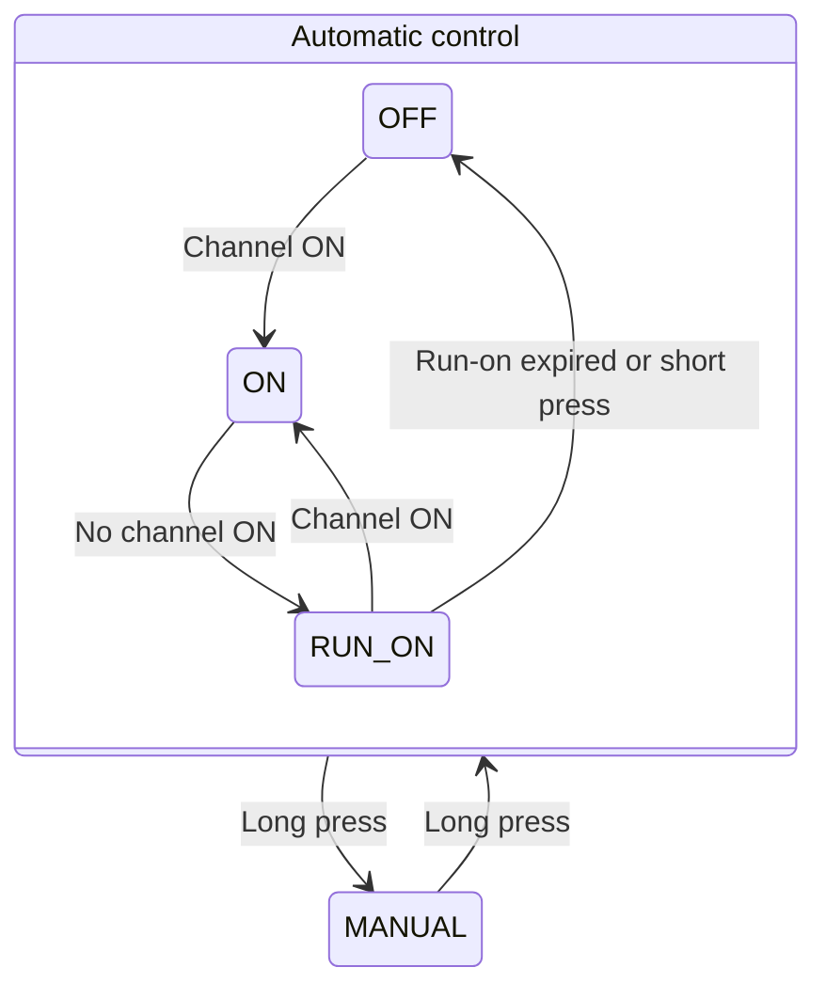
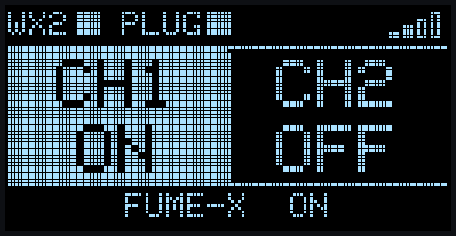
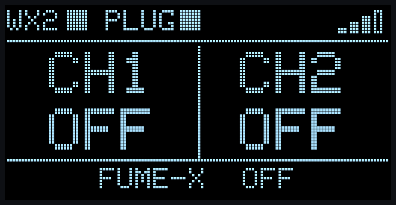
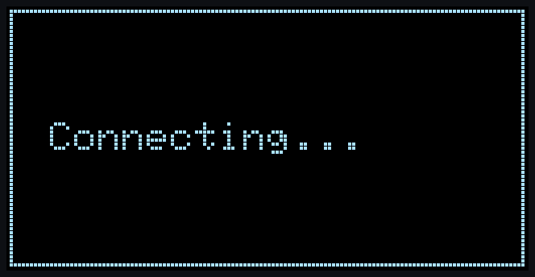
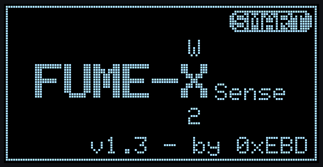

# PoC Software - ESP32-C3 – From "Hello WX2" to a Workbench-Ready Skeleton

← Back to the [PoC overview](../README.md) · See also: [Hardware](../hw/README.md)

⚠️ Before running the software, read the Safety and Disclaimer sections of the [PoC overview](../README.md).

## What Changed Since “Hello WX2”

**Same embedded foundation, plus a local HMI and manual control.** The [“Hello WX2” software](../../001_hello_wx2/sw/README.md) was extended in place, retaining WX2 communication and local Shelly control. This iteration adds an OLED HMI, push-button control with manual mode and run-on cancellation, and a startup splash screen.

## Overview / BOM

<table>
  <thead>
    <tr><th>Component</th><th>Details</th></tr>
  </thead>
  <tbody>
    <tr><td>MCU</td><td>Seeed Studio XIAO ESP32-C3</td></tr>
    <tr><td>Framework</td><td>Arduino framework for ESP32</td></tr>
    <tr><td>Libraries</td><td>ESP32 core libraries + Adafruit SSD1306 / GFX, see <a href="#arduino-libraries">Arduino Libraries</a></td></tr>
    <tr><td>WX2 interface</td><td>UART1, 1200 baud, 8N1 via the MAX3232 RS-232 transceiver on the B1 sample board (see <a href="../hw/README.md">Hardware</a>)</td></tr>
    <tr><td>Shelly interface</td><td>Wi-Fi / local HTTP RPC API</td></tr>
    <tr><td>Display interface</td><td><b>New:</b> I²C, 128×64 OLED with SSD1306 controller at address <code>0x3C</code></td></tr>
    <tr><td>Application</td><td><a href="fxs_poc_skeleton/fxs_poc_skeleton.ino"><code>fxs_poc_skeleton.ino</code></a></td></tr>
    <tr><td>Splash screen</td><td><b>New:</b> <a href="fxs_poc_skeleton/wx2_splash.h"><code>wx2_splash.h</code></a></td></tr>
    <tr><td>Configuration</td><td><code>secrets.h</code> for Wi-Fi credentials and Shelly IP address</td></tr>
  </tbody>
</table>

### Arduino Libraries

<table>
  <thead>
    <tr><th>Library</th><th>Header</th><th>Source</th><th>Used for</th></tr>
  </thead>
  <tbody>
    <tr><td>Arduino core / HardwareSerial</td><td><code>Arduino.h</code></td><td>ESP32 board package</td><td>UART1 to the WX2, USB serial log, GPIO for the push button</td></tr>
    <tr><td>WiFi</td><td><code>WiFi.h</code></td><td>ESP32 board package</td><td>Station mode, connection status, RSSI for the signal bars</td></tr>
    <tr><td>HTTPClient</td><td><code>HTTPClient.h</code></td><td>ESP32 board package</td><td>Shelly RPC requests (HTTP GET)</td></tr>
    <tr><td>Wire</td><td><code>Wire.h</code></td><td>ESP32 board package</td><td><b>New:</b> I²C bus for the OLED</td></tr>
    <tr><td>Adafruit SSD1306</td><td><code>Adafruit_SSD1306.h</code></td><td>Arduino Library Manager</td><td><b>New:</b> OLED driver, frame buffer</td></tr>
    <tr><td>Adafruit GFX Library</td><td><code>Adafruit_GFX.h</code></td><td>Arduino Library Manager</td><td><b>New:</b> text, shapes and default font for HMI and splash</td></tr>
  </tbody>
</table>

<!-- TODO: record the tested ESP32 board package and Adafruit library versions. -->

No JSON library is used: the two Shelly response fields are extracted with a minimal string search.

## ESP32 Application

The ESP32 application extends the basic fumeXsense control loop with local status feedback and push-button operation.

The XIAO ESP32-C3 communicates with the Weller WX2 through the PoC hardware, evaluates the channel state and controls the fume extractor through a Shelly Plug S Gen3.

The system chain remains:

**WX2 → RS-232 → ESP32-C3 → Wi-Fi → Shelly Plug → 230 V → Fume Extractor**

The OLED displays channel and extractor status. The push button provides manual continuous operation and cancellation of the run-on delay.

ℹ️ This PoC is vibe-coded: the software was generated with AI assistance, then reviewed and tested on the hardware. The implementation deliberately remains simple and synchronous.

### Software Structure

One Arduino sketch, one main loop, shared global state:

<table>
  <thead>
    <tr><th>Part</th><th>Main functions</th><th>Responsibility</th></tr>
  </thead>
  <tbody>
    <tr><td>WX2 protocol</td><td><code>wxCommand()</code>, <code>wxRead()</code></td><td>Send commands, read and checksum-check response frames</td></tr>
    <tr><td>Shelly RPC</td><td><code>shellySet()</code>, <code>shellyValidate()</code></td><td>Switch the relay, read back relay state and power</td></tr>
    <tr><td>Extractor logic</td><td><code>extractorLogic()</code></td><td>Automatic channel-based control and 30 s run-on timer, with manual override and run-on cancellation</td></tr>
    <tr><td>Push button</td><td><code>buttonPoll()</code>, <code>buttonService()</code></td><td>Detect press events, execute them outside the WX2 transactions</td></tr>
    <tr><td>OLED HMI</td><td><code>oledRender()</code></td><td>Render status and visual indicators; no extractor control decisions</td></tr>
    <tr><td>Splash screen</td><td><code>wx2_splash()</code></td><td>Boot animation, runs once at startup</td></tr>
  </tbody>
</table>

Everything runs in sequence in `loop()`: poll the WX2, execute button events, run the extractor logic, render the display, then pause for 1 s while watching the button.

Communication calls are blocking. A typical cycle takes about 1.5 s when both devices respond normally. Communication delays and timeouts extend the cycle and delay display updates and button-event handling.

### WX2 Communication

The WX2 communication uses the Weller serial protocol referenced in [“Hello WX2”](../../001_hello_wx2/sw/README.md#wx2-communication), based on application note **WAN12-0006**.

- **Serial link:** UART1, 1200 baud, 8N1
- **Response frames:** 7 bytes, with a checksum equal to the sum of the first six bytes modulo 256
- **Receive timeout:** 1.5 s

<table>
  <thead>
    <tr><th>Command</th><th>When</th><th>Purpose</th></tr>
  </thead>
  <tbody>
    <tr><td><code>remote1</code></td><td>startup</td><td>Enable remote mode</td></tr>
    <tr><td><code>?</code></td><td>startup</td><td>Identify station type</td></tr>
    <tr><td><code>Q</code></td><td>every cycle</td><td>Channel status (1 frame)</td></tr>
    <tr><td><code>R</code></td><td>every cycle</td><td>Actual temperatures (2 frames)</td></tr>
    <tr><td><code>S</code></td><td>every cycle</td><td>Set temperatures (2 frames)</td></tr>
    <tr><td><code>Y</code></td><td>every cycle</td><td>Connected tools (2 frames)</td></tr>
  </tbody>
</table>

See [Hardware](../hw/README.md) for details of the physical WX2 interface.

### Extractor Control

In automatic mode, the extractor follows the WX2 channel state:

- At least one channel ON → extractor ON
- No channel ON → extractor OFF after a fixed 30 s run-on delay
- Short press during run-on → cancel the remaining delay and request extractor OFF
- Long press → enter manual mode and request extractor ON continuously
- Long press in manual mode → return to automatic control without starting a new run-on
- Low-power warning when the reported relay state is ON but reported power is below 5 W

The Shelly Plug S Gen3 is controlled through its local HTTP RPC API. No cloud connection is required for normal operation.

<table>
  <thead>
    <tr><th>RPC call</th><th>When</th><th>Purpose</th></tr>
  </thead>
  <tbody>
    <tr><td><code>Switch.Set?id=0&amp;on=…</code></td><td>on change</td><td>Switch the extractor</td></tr>
    <tr><td><code>Switch.GetStatus?id=0</code></td><td>every 10 s, after each switch</td><td>Read <code>output</code> (relay state) and <code>apower</code> (power)</td></tr>
  </tbody>
</table>

Requests use HTTP GET at `/rpc/…`, with a configured timeout of 2 s. The 10 s validation interval is nominal: blocking calls can delay the next validation.

In manual mode, an external OFF command from the Shelly app or plug button is overridden during the next successful validation and switching sequence. In automatic mode, external state changes remain subject to channel-based control and the run-on logic.

#### Extractor State Machine

The diagram summarizes the operating states. The code has no explicit state variable — the state follows from the manual-mode flag, the desired relay state and the channel status.



Entry behavior is described separately to distinguish startup from leaving manual mode:

- **At startup:** the initial automatic state follows the reported plug state: OFF if the plug is OFF, or RUN_ON if the plug is ON. Subsequent WX2 polling updates the automatic control.
- **When leaving manual mode:** automatic control goes straight to ON or OFF according to the current channel state, without starting a new run-on.

- **Before the first valid WX2 response:** both channels are unknown (`?`) and count as “no channel ON”. If the plug is ON at startup, it is switched off after the 30 s run-on.
- **Leaving manual mode without Shelly response:** the switching request fails, the desired state stays unchanged, and automatic control repeats the request in the following cycles.

#### Communication Loss and State Feedback

The desired relay state is the firmware's control target. The last reported relay state is feedback from the Shelly. These values can differ, and a previous status response does not confirm the current physical state when communication is lost.

- **WX2 communication lost:** the last known channel state is retained. If a channel was ON, automatic control continues to request extraction. If all channels were OFF, no new channel activity can be detected until communication resumes.
- **Shelly communication lost:** the current relay state cannot be confirmed. A failed switching request must not be interpreted as proof that the requested state was applied.
- **Failed switching request:** the desired state is only updated on success. Automatic control therefore repeats the request every cycle; a failed manual ON is repeated by the next Shelly validation (nominally every 10 s). A failed short press during run-on is not repeated, but the run-on still expires and switches the extractor off.
- **Display feedback:** relay and power information can become stale between successful status responses.

### OLED HMI

The 128×64 display is split into three bands:


<table>
  <thead>
    <tr><th>Band</th><th>Element</th><th>Meaning</th></tr>
  </thead>
  <tbody>
    <tr><td rowspan="3">Top — status</td><td>WX2 □/■</td><td>Filled when a valid channel-status frame was received</td></tr>
    <tr><td>PLUG □/■</td><td>Filled when the last Shelly status request returned a response (HTTP 200, non-empty body); the status fields are not checked. Not a continuous connection guarantee</td></tr>
    <tr><td>Signal bars</td><td>Wi-Fi RSSI in four levels, using thresholds of −55, −65 and −75 dBm; empty when disconnected</td></tr>
    <tr><td rowspan="3">Middle — channels</td><td>Black background</td><td>Channel OFF (or unknown: <code>?</code>)</td></tr>
    <tr><td>White background</td><td>Channel ON</td></tr>
    <tr><td>Blinking background</td><td>Channel STBY (standby) or AUTO (auto-off)</td></tr>
    <tr><td rowspan="4">Bottom — extractor</td><td>FUME-X ON / OFF</td><td>Last reported Shelly relay state; band white while reported ON</td></tr>
    <tr><td>Shrinking bar</td><td>Run-on active: the bar shows the remaining time of the 30 s delay</td></tr>
    <tr><td>Blinking band</td><td>Low-power warning: reported relay state ON, but reported power below 5 W</td></tr>
    <tr><td>MAN badge</td><td>Manual mode active</td></tr>
  </tbody>
</table>

<table>
  <tr>
    <td><br>Run-on countdown</td>
    <td><br>Manual mode</td>
    <td><br>Low-power warning (dark phase)</td>
  </tr>
  <tr>
    <td><br>Idle</td>
    <td><br>WX2 / Shelly not reachable</td>
    <td><br>Connecting to Wi-Fi</td>
  </tr>
</table>

ℹ️ The screens are pixel-accurate renderings of the display code, using the Adafruit GFX default font.

If no display is detected at startup, the firmware prints a warning on the serial console and continues without it.

### Push Button

<table>
  <thead>
    <tr><th>Action</th><th>When</th><th>Effect</th></tr>
  </thead>
  <tbody>
    <tr><td>Short press (&lt; 800 ms, detected on release)</td><td>During run-on</td><td>Cancel the remaining run-on and request extractor OFF when the event is processed</td></tr>
    <tr><td>Short press</td><td>Otherwise during normal operation</td><td>No effect</td></tr>
    <tr><td>Long press (≥ 800 ms, detected while held)</td><td>Automatic mode</td><td>Enter manual mode: request extractor ON continuously</td></tr>
    <tr><td>Long press</td><td>Manual mode</td><td>Return to automatic control according to the channel state, without starting a new run-on</td></tr>
    <tr><td>Button press (first detected LOW level)</td><td>During the splash screen</td><td>Skip the splash</td></tr>
  </tbody>
</table>

During normal operation, debounce time is 30 ms. The 800 ms threshold is the press-duration threshold, not a guaranteed response time: blocking communication can delay button sampling and event processing.

A long press returns from manual mode to automatic mode. A reboot also clears manual mode.

### Splash Screen

At startup, [`wx2_splash.h`](fxs_poc_skeleton/wx2_splash.h) shows an animated logo lasting about 5 s, drawn entirely with Adafruit GFX text and shape primitives — no bitmaps:



During the splash screen, the first detected LOW level on the button input skips the animation. This deliberately bypasses the normal button debounce and press-duration handling because an accidental skip is harmless.

### Serial Output

The serial log extends the “Hello WX2” output with button events and the manual-mode marker. Illustrative example:

<!-- TODO: replace with a real capture from the B1 test. -->

```text
--------------------------
CH1: OFF       CH2: OFF
Actual temp  CH1: 212.4 C   CH2: 27.9 C
Set temp     CH1: 350.0 C   CH2: 350.0 C
Tools        CH1: WXMP   CH2: WXMT
[btn] long: manual mode ON (continuous run)
Extractor -> ON
Extractor: desired=ON  actual=ON  23.7 W  [MANUAL]
```

In the log, `desired` is the control target and `actual` represents the last reported Shelly relay state.

The high-level system features are described in the [PoC overview](../README.md).

## Known Limitations

This is intentionally simple PoC software developed for rapid functional validation, not a production software baseline.

- Blocking, synchronous implementation: display updates and button handling share the loop with communication. The typical display update interval is about 1.5 s when both devices respond normally; updates pause during blocking communication calls.
- The button is not sampled during Shelly HTTP requests. A press that starts and ends within such a request can be missed; other presses may be detected or processed late.
- WX2 connection lost: the last known channel state is retained. If a channel was ON, automatic control continues to request extraction. New channel activity cannot be detected while communication is unavailable.
- Shelly relay and power feedback can become stale. The desired relay state does not confirm that the physical relay has switched.
- In automatic mode, switching the Shelly ON via the app while no channel is ON and the run-on has elapsed is overridden by automatic control. Detection and correction depend on Shelly validation and communication timing.
- Temperatures are read but not displayed.
- Manual mode is not persisted across reboots.
- Configuration such as Shelly IP, run-on delay and GPIO assignment is fixed at compile time.
- Limited error handling and recovery; no Shelly authentication support.
- Known issue (unchanged): CR/LF bytes are discarded by the receive routine, which can cause sporadic checksum failures if the checksum itself is `0x0D` or `0x0A`.
- No automated tests; tested with a single hardware setup.

The implementation intentionally prioritizes a short feedback loop and transparent behavior over production-level software architecture.

See the [PoC overview](../README.md) for the overall PoC maturity and lessons learned.

## Build & Run

### Prerequisites

- Seeed Studio XIAO ESP32-C3
- Arduino IDE with ESP32 board support
- Libraries via Arduino Library Manager: **Adafruit SSD1306** and **Adafruit GFX Library**
- B1 sample board (or equivalent wiring) connected to the WX2 (see [Hardware](../hw/README.md))
- Shelly Plug S Gen3 connected to the local Wi-Fi network
- Shelly authentication disabled

### Setup

In the folder containing `secrets.h.example`, copy the example configuration:

```bash
cp secrets.h.example secrets.h
```

Alternatively, duplicate the file in your file manager and rename the copy to `secrets.h`.

Configure the local network and Shelly address in `secrets.h`:

```cpp
#define SECRET_WIFI_SSID "your-ssid"
#define SECRET_WIFI_PASS "your-password"
#define SECRET_SHELLY_IP "192.168.x.x"
```

> 🔒 `secrets.h` contains your Wi-Fi credentials. It is listed in `.gitignore` and must never be committed to the repository.

Recommended: assign a fixed IP address to the Shelly using a DHCP reservation or static IP configuration.

### Build & Flash

Open [`fxs_poc_skeleton/fxs_poc_skeleton.ino`](fxs_poc_skeleton/fxs_poc_skeleton.ino) in the Arduino IDE, select the **XIAO ESP32-C3** board and the device's port, then flash the sketch.

Open the serial monitor at **115200 baud**.

At startup, the application:

1. Initializes the WX2 UART and the push button.
2. Initializes the OLED and shows the splash screen.
3. Shows “Connecting…” and connects to Wi-Fi.
4. Enables WX2 remote mode and identifies the WX station.
5. Reads the current Shelly state.
6. Starts polling the WX2, controlling the extractor and updating the display.

← Back to the [PoC overview](../README.md) · See also: [Hardware](../hw/README.md)
